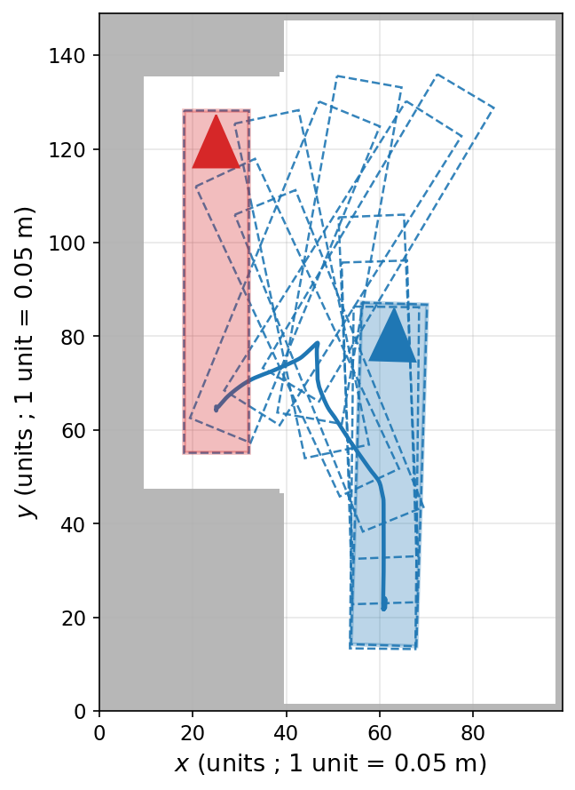

# shfm: State-embedded Hamiltonian Fast Marching

This repository contains `shfm`, a path planner for forklifts with two
independently steered axles, together with its tutorial notebooks and the
scripts and data that redraw the computed figures and tables of the PhD thesis
it accompanies, except the solve times.
The planner computes globally optimal paths in the extended configuration
space `(x, y, θ, s)`, where `s` is the operational mode of the vehicle:
forward or backward, in navigation (the front axle steers) or in manoeuvre
(both axles steer, crab motion included). The eikonal equation is solved on
the GPU with the anisotropic solver of the `agd` library by J.-M. Mirebeau,
and the paths are compared with those of the sampling planners of Bench-MR;
both libraries are vendored under `external/`.

<p align="center">
  
</p>

Four-wheel-steering vehicles can crab sideways and turn on a much tighter
radius than a car. Planners that ignore this forgo the shortcuts such a
vehicle could take; those that expose every motion use crab motion everywhere,
including down open corridors where it serves no purpose and unsettles anyone
working nearby. We
keep both behaviours available and assign a cost to each change of mode, so
that manoeuvring is reserved for the places whose geometry requires it. The
changes of mode are part of the optimisation, not a post-processing step, so
the returned path stays globally optimal for the chosen cost.

The method comes from the PhD thesis of Julien Pascal, presented
[below](#the-thesis), and from the publications listed at the end of this
file.

## Install

You need Linux on x86-64 with an NVIDIA GPU and its driver, and conda.

```bash
git clone https://github.com/PascalJulien/State-HFM
cd State-HFM
conda env create -f environment.yml
conda activate shfm
pip install -e .
python scripts/check_install.py
```

That is enough to plan paths. Measuring them (notebooks 03, 05, 06, 07 and
08, and the figure scripts that measure paths or draw Bench-MR plates) needs
the vendored Bench-MR, built by `./scripts/setup.sh` from system libraries:
OMPL 1.5, SBPL, Boost, Eigen and CMake. [docs/install.md](docs/install.md)
gives the full requirements, the configuration the results were produced
with, and what to do when conda is slow.

## Quick start

```bash
python examples/hello_world.py
```

plans one path on the Two-Rooms map and draws it, coloured by mode, to
`figures/hello_world.png`. Below is its planning part, with one line added:

```python
from shfm import from_image, Planner, REFERENCE_COEFFICIENTS

env = from_image("data/maps/two_rooms.png", (100, 100), zoom=4)
planner = Planner(env, k1=2, k2=3, **REFERENCE_COEFFICIENTS)

start, goal = [30, 70, 0.0, 0], [90, 80, 3.14, 0]   # x, y (grid units), heading (rad), mode
result = planner.solve(seed=start, tips=[goal], free_start_mode=True)
path = result.path(0)               # (n, 4): x, y, heading, mode, from start to goal
print(result.modes_used(0))         # share of the points per mode, by solver index
```

`zoom` sets the scale: the vehicle is 3.649 m long, so at `zoom=4` it spans
14.6 grid units and one unit is 25 cm. Every length the planner reports is in
grid units; only the swept area is returned in square metres. `k1 = 2`,
`k2 = 3` are the transition costs; [docs/parameters.md](docs/parameters.md)
explains them. The front is propagated from the start, `seed`, and each goal
of `tips` is reached by following it back, so one solve gives a path to every
goal. `free_start_mode` lets the vehicle leave in any mode at no transition
cost.

[`examples/your_own_problem.ipynb`](examples/your_own_problem.ipynb) applies
the planner to a scene of your own: a map built in metres or read from a floor
plan, the dimensions of the vehicle, 2WS or 4WS, the transition costs, several
goals from one solve, the path in metres written to CSV, and what to check
when a path is missing or wrong.

## Notebooks

The notebooks form the tutorial, to be read in order. Each runs on its own,
except notebook 08, which reads the statistics notebook 07 writes to `runs/`.

| # | notebook | contents |
|---|---|---|
| 00 | Overview | what the method does, and the shape of the problem |
| 01 | Vehicle and kinematics | the 4WS model, its steering modes, Tissot's indicatrix, the turning radius |
| 02 | Collision and configuration space | the disc covering, the lift to 3D |
| 03 | Hamiltonian Fast Marching | the value function, reading a path off it, the obstacle cost |
| 04 | The state system | the four modes, transition costs, the extended equation |
| 05 | Precision docking and narrow passages | the narrow slot and the narrow corridor, 2WS against 4WS |
| 06 | Discretisation and parameters | grid resolution, then the model parameters |
| 07 | Benchmarks | three scenes against RRT, RRT*, Informed-RRT*, SST, SPARS |
| 08 | Benchmark metrics | the metrics, the table, and how the solver scales |
| 09 | The scheme, step by step | the adaptive stencil and one update, by hand |

Those that draw a figure of their own write it under `figures/`; notebooks 02
and 06 only run scripts of `generators/` and display the files the scripts
write, and 01 and 03 run one each. The examples under `examples/` stand apart
from this sequence: a first script, and the planner applied to a problem of
your own.

## The thesis

This repository accompanies the PhD thesis of Julien Pascal, *Planification
de trajectoire sous contraintes pour robot à deux trains directeurs
indépendants. Application à la navigation d'un chariot à fourche automatisé
dans des entrepôts encombrés* (Université Clermont Auvergne, Institut Pascal,
2026, in French), which calls the method SHFM, State Hamiltonian Fast
Marching. Its figures and tables that come from a computation can be produced
again from here, except the solve times of tab. 5.5, which depend on the
machine: [docs/reproducing-the-thesis.md](docs/reproducing-the-thesis.md) says
how.

## Documentation

* [docs/parameters.md](docs/parameters.md): units and `zoom`, the vehicle, the
  speed coefficients, the transition costs, the obstacle cost. Read this one
  first.
* [docs/api.md](docs/api.md): the module by module reference.
* [docs/notes.md](docs/notes.md): how the metrics are computed, the order of
  the paths and of the modes, the Bench-MR footprint, why no transition cost
  is zero.
* [docs/troubleshooting.md](docs/troubleshooting.md): from a symptom to its
  cause and its fix, for the installation, the GPU, Bench-MR and the planning.
* [docs/figures.md](docs/figures.md): what the scripts and the notebooks write.
* [docs/install.md](docs/install.md): requirements and installation.
* [docs/README.md](docs/README.md): the index of this documentation, and the
  layout of the repository.

## Publications

* J. Pascal, J.-M. Mirebeau, B. Thuilot, P. Checchin. *Path Planning for
  Four-Wheel Steering Forklifts in Constrained Spaces: A State-Embedded
  Hamiltonian Fast Marching Approach.* 2026 IEEE International Conference on
  Robotics and Automation (ICRA), Vienna, Austria, pp. 6279-6286.
  doi:[10.1109/ICRA57385.2026.11697493](https://doi.org/10.1109/ICRA57385.2026.11697493)
* J. Pascal, J.-M. Mirebeau, B. Thuilot, P. Checchin. *A State-Embedded
  Hamiltonian Fast Marching Approach for Four-Wheel Steering Forklifts Path
  Planning in Constrained Spaces.* 23rd IFAC World Congress, Busan, Republic of
  Korea, 2026. IFAC-PapersOnLine, to appear.
* J. Pascal. *Planification de trajectoire sous contraintes pour robot à deux
  trains directeurs indépendants. Application à la navigation d'un chariot à
  fourche automatisé dans des entrepôts encombrés.* PhD thesis, Université
  Clermont Auvergne, 2026.

## Preparation of this repository

The code was written during the thesis. Its preparation for publication
(cleaning, comments, documentation, notebooks and examples) was done with the
help of an AI assistant, Claude (Anthropic), and checked by the author; the
figures and tables it redraws were compared with those of the thesis
([docs/reproducing-the-thesis.md](docs/reproducing-the-thesis.md)).

## Citation

If you use this code, please cite the ICRA 2026 paper above;
[`CITATION.cff`](CITATION.cff) gives the reference in machine-readable form.
The solver and the benchmark have references of their own, which the thesis
cites as well:

* J.-M. Mirebeau, J. Portegies. *Hamiltonian Fast Marching: A Numerical Solver
  for Anisotropic and Non-Holonomic Eikonal PDEs.* Image Processing On Line,
  9, pp. 47-93, 2019. doi:[10.5201/ipol.2019.227](https://doi.org/10.5201/ipol.2019.227)
* J.-M. Mirebeau, L. Gayraud, R. Barrère, D. Chen, F. Desquilbet. *Massively
  parallel computation of globally optimal shortest paths with curvature
  penalization.* Concurrency and Computation: Practice and Experience, 35(2),
  e7472, 2023. doi:[10.1002/cpe.7472](https://doi.org/10.1002/cpe.7472)
* E. Heiden, L. Palmieri, L. Bruns, K. O. Arras, G. S. Sukhatme, S. Koenig.
  *Bench-MR: A Motion Planning Benchmark for Wheeled Mobile Robots.* IEEE
  Robotics and Automation Letters, 6(3), pp. 4536-4543, 2021.
  doi:[10.1109/LRA.2021.3068913](https://doi.org/10.1109/LRA.2021.3068913)

## License

Apache License 2.0, see [`LICENSE`](LICENSE). The vendored libraries under
`external/` keep their own licences, listed in
[`external/NOTICE.md`](external/NOTICE.md).
